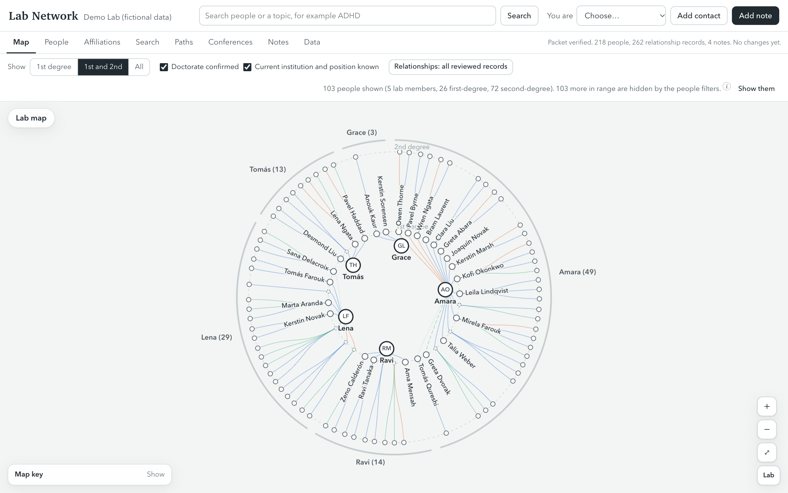
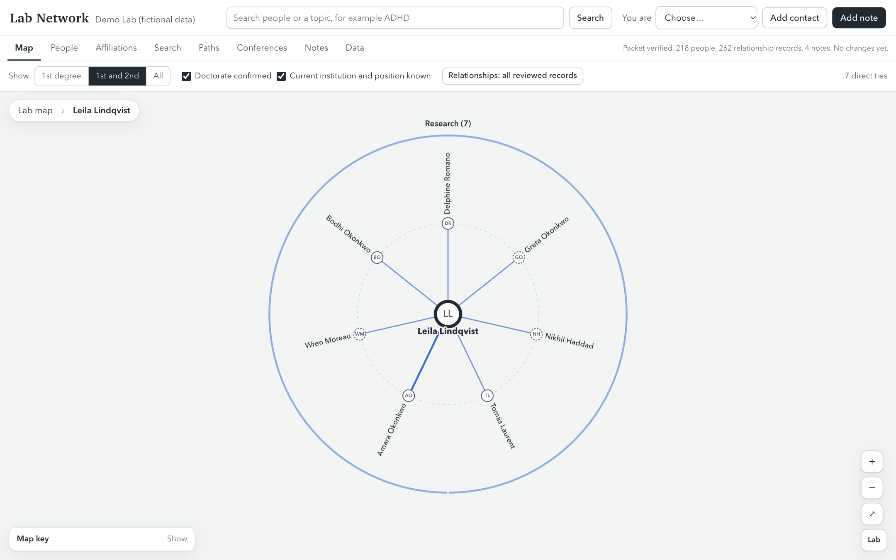
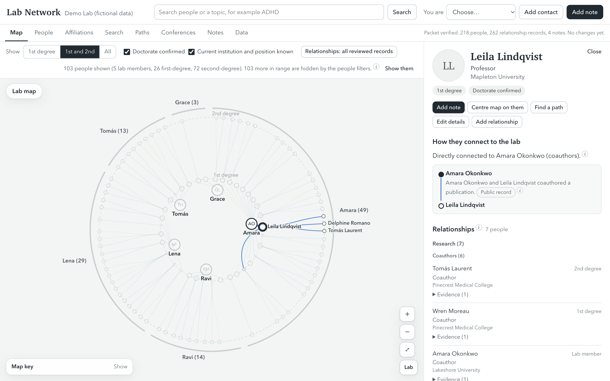
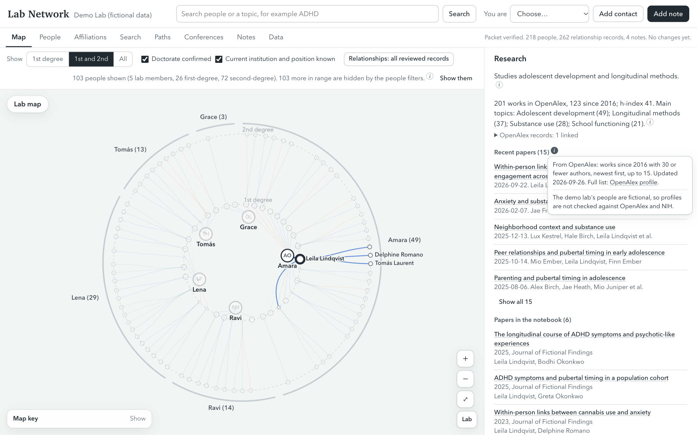
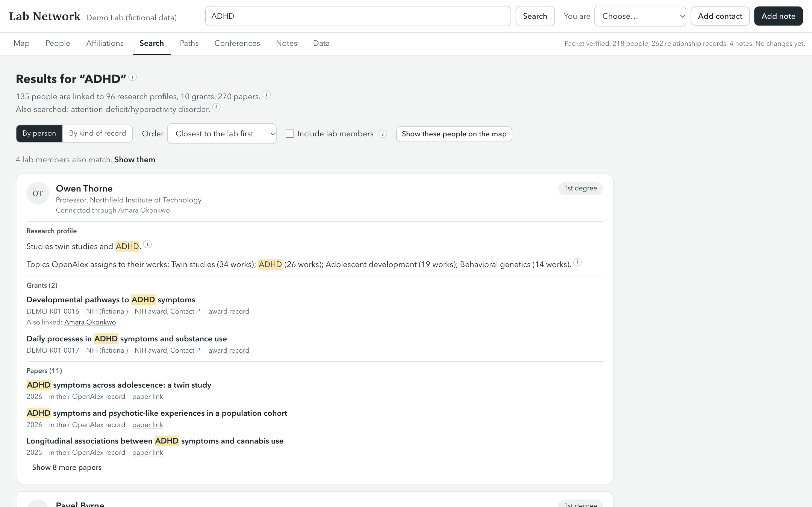
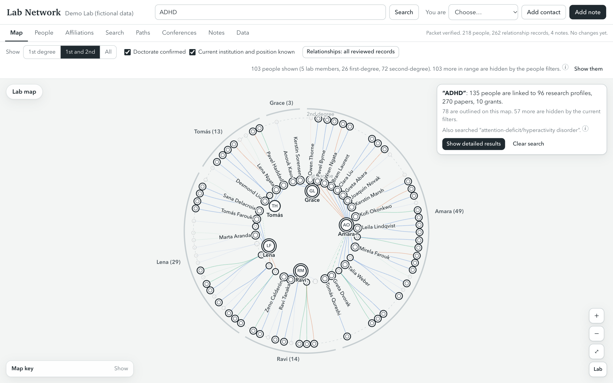
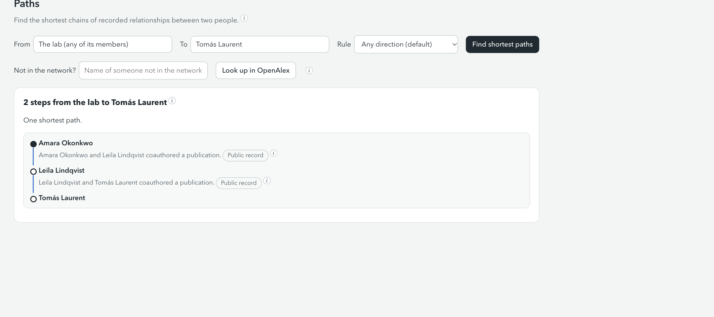
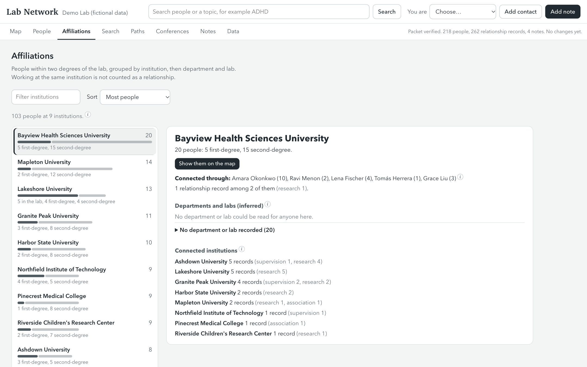
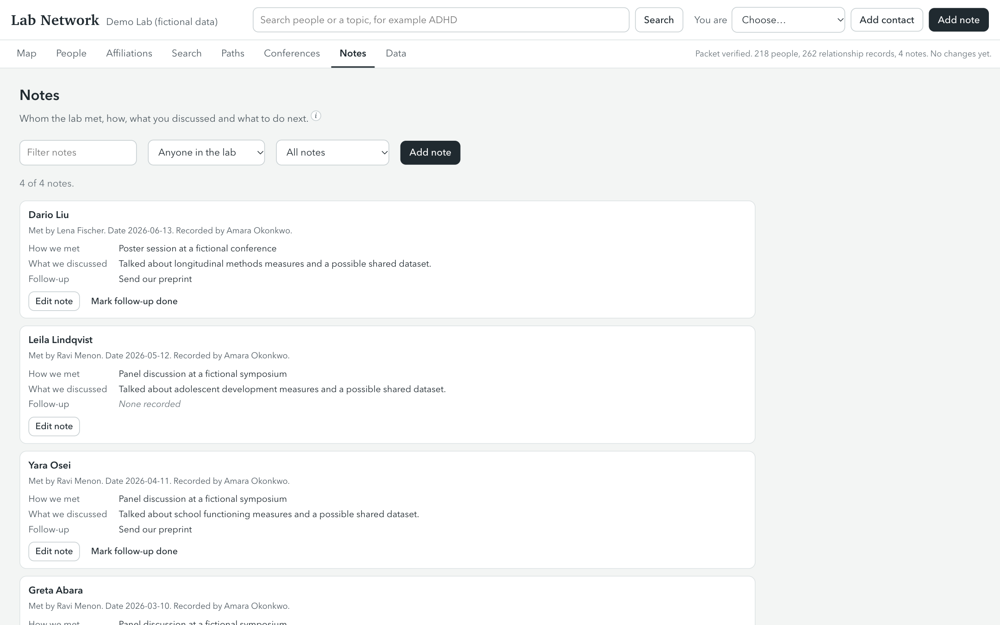
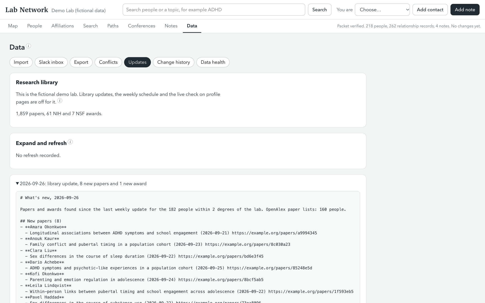

# Lab Network

Lab Network is a private record of your lab's professional network. It shows who the lab knows, how each person
connects to the lab and on what evidence, what they work on, and what you discussed when you met. It runs on your own
computer with nothing but Python, fills itself in from public records (OpenAlex, ORCID, NIH RePORTER and NSF), and
keeps your notes and edits as dated changes you can export.



## Set it up with your AI assistant

Open this folder in an AI coding assistant (Claude Code, Codex, Cursor or similar) and say:

> Set up Lab Network for my lab.

The assistant follows [AGENTS.md](AGENTS.md). It asks for two things: your lab's website (or your name and
institution) and your permission to look up public records. It reads your lab's people page, shows you the member list
it drafted, and builds the network once you confirm. It asks you to choose between people only when a name matches
several researchers, and shows the evidence for each. It then collects your lab's coauthors and their coauthors, so
the first and second degree are complete, builds the research library, and starts the app.

Plan on about fifteen minutes of your time. The library build takes 10 to 40 minutes more and runs unattended; a free
[OpenAlex API key](https://openalex.org/settings/api) lets a large network finish in one run (see
[the research library](#the-research-library)).

## Try the demo lab

To look without installing anything, open the [live demo](https://jonschaefer89.github.io/lab-network/): the
fictional lab, read-only, running in your browser. The first visit downloads about 6 MB.

To run it on your computer, you need Python 3.9 or newer. Nothing else is installed.

```bash
git clone https://github.com/jonschaefer89/lab-network.git
cd lab-network
python3 labnetwork.py demo --open
```

The browser opens a fictional lab of 218 people, with a research library of their papers and awards and one weekly
digest. Everything in the demo is made up, every link points to example.org, and the demo never contacts an outside
service. The screenshots on this page come from it.

## A tour of the app

### Map the network

The lab sits at the centre and each ring out is one more step of recorded relationships. Each lab member has a sector
holding the people connected through them. Line colour shows the kind of relationship (supervision, research or
association) and line style shows the evidence: solid for a public record, dashed for a reported relationship, dotted
for a firsthand record (someone in the lab saw or took part in it). Filters narrow the map to the first degree, to people with a confirmed doctorate, or
to particular kinds of relationship. "Centre map on them" shows one person's own ties.



### See how anyone connects to the lab, and why

Every person's page lists the shortest chains of recorded relationships back to the lab, each step with its source
and kind of evidence, followed by all of their recorded relationships grouped by kind.



### Read their research record

For the researchers within two degrees, the research library holds their OpenAlex summary, up to 50 recent papers,
and their NIH and NSF awards. Of the people `expand` adds to the second degree, it holds those with a confirmed doctorate and a known institution and position. Sources, dates and rules sit behind the small "i" marks, so the page shows the facts first.



### Find people for a project

Search a topic such as ADHD. Results list each person with their degree of connection and the research profile,
grants, papers and notes that matched. Join terms with AND (`ADHD AND ABCD`) to find people with work on both. "Show
these people on the map" outlines them in the network.





### Plan an introduction

The Paths page finds the shortest chains between any two people, or between the lab and someone. For someone outside
the network, it looks their name up in OpenAlex and lists the people in your network who have published with them.



### See institutions and labs

The Affiliations page groups everyone within two degrees by institution, then department and lab, and lists the
relationships recorded between institutions. Working at the same institution never counts as a relationship.



### Keep notes and follow-ups

After a meeting, add a note: how you met, what you discussed, and what you promised to send. The Notes page lists
every note and the open follow-ups.



### Stay current

A weekly update on your computer adds new papers and NIH and NSF awards for the people in the research library and
writes a digest, which the Data page shows under Updates.



### Also

- **Conferences.** Import a conference's public program, and the Conferences page lists who in your network is on it,
  in which years and roles.
- **Lab members add from Slack.** They post a short form in a private Slack channel, and Lab Network adds each
  person, relationship and meeting note under their name, automatically or after your review.
  [docs/slack-intake.md](docs/slack-intake.md)
- **A read-only copy for the lab.** Build a copy that runs entirely in the browser and put it online behind a
  sign-in that admits only your lab. [docs/hosting.md](docs/hosting.md)

## Where the data comes from

| Source | What Lab Network takes from it | Needs |
|---|---|---|
| You and your lab | Members, roles, photos, and relationships papers do not show: mentors, trainees, committees, fellowship peers | Your answers during setup |
| [OpenAlex](https://openalex.org) | Papers since a year you choose, coauthors, last known affiliations, research topics | Nothing; a free key raises the daily allowance |
| [ORCID](https://orcid.org) | Earned doctorates and current positions, when a person lists them | Nothing (public records) |
| [NIH RePORTER](https://reporter.nih.gov) | Awards and the principal investigators named on them | Nothing |
| [NSF award search](https://www.research.gov/common/webapi/awardapisearch-v1.htm) | NSF awards and their principal investigators | Nothing |
| Google Scholar | Used only so you can confirm identities | Nothing is read automatically |

Google Scholar has no public API and its terms do not allow automated reading, so Lab Network never scrapes it.

## Rules Lab Network follows

- **Degrees come from recorded relationships.** A shared institution or research topic never counts as a connection.
- **Evidence travels with every relationship.** Each one keeps its source, its kind of evidence (public record,
  reported, or firsthand note), its confidence and its review status.
- **A person confirms every identity.** When a name matches several researchers, Lab Network asks; it never picks.
- **Missing is shown as missing.** "Doctorate not classified" means nobody has checked, not that the person has no
  doctorate.
- **The starting data is never edited.** Your edits, notes and imports are stored as dated changes beside it, and
  nothing is overwritten by an import: a value that differs from yours becomes a conflict for someone to resolve.

## Your data stays on your computer

The app listens only on 127.0.0.1 and has no accounts, analytics or cloud storage. Lookups send names and IDs to
OpenAlex, ORCID, NIH RePORTER and NSF; the Slack intake, if you set it up, reads one channel and never posts; and the
read-only copy goes online only if you build and deploy it yourself. [docs/privacy.md](docs/privacy.md) lists every
outside contact. Keep your lab folder outside this repository; `.gitignore` excludes the usual locations.

## Set up by hand

```bash
python3 labnetwork.py onboard ~/LabNetwork/my-lab          # questions in the terminal, then the build
python3 labnetwork.py serve ~/LabNetwork/my-lab/workspace --open
```

[docs/onboarding.md](docs/onboarding.md) explains each question and the `lab.json` file the command writes.

### Fill in the first and second degree

Onboarding keeps each lab member's most frequent coauthors (40 by default) and up to 5 frequent coauthors of each of
them. `expand` adds the rest: every coauthor on lab members' papers with 30 or fewer authors, and everyone who shares two
or more such papers since the start year with someone in the first degree, including people the same run joins to a
lab member. A preprint and its article count as one paper, and corrections not at all. It reads every OpenAlex record
linked to a person and the papers they list on ORCID. OpenAlex sometimes files two researchers with the same name under
one record, so a paper counts only when it names someone already in the network (other than people that `expand` or
onboarding added to the second degree), was recorded with a lab member, or lists the person at their recorded
institution or at an institution where two such papers list them. A person confirms a lab member's OpenAlex record,
not each paper on it, so a lab member's paper counts when it names another lab member, someone whose relationship with
the lab is more than a coauthor record written from OpenAlex (onboarding, `expand` and the scheduled refresh write
those, and their evidence says "indexed by OpenAlex"), or someone named on another member's papers that count;
is on the ORCID record whose iD is on the member's own record; or lists them at their recorded institution or at an
institution where two such papers list them. A first-degree person whose only relationship with the lab is a coauthor
record written from OpenAlex keeps it, but `expand` collects their coauthors only when one of those papers names them;
their profile says why it did not. If you add the lab member's ORCID iD to their record, or record a relationship with
one of the paper's coauthors, the paper counts. An ORCID iD that OpenAlex shows on a lab member's author record is
listed in the run's digest for you to check, and it does not count until you add it.
`--per-person N` adds at most N people for each first-degree person.

```bash
python3 labnetwork.py expand ~/LabNetwork/my-lab/workspace --dry-run   # who would be added, and the cost
python3 labnetwork.py expand ~/LabNetwork/my-lab/workspace             # apply, as one import batch
```

A second run adds only the missing records, so a run that plans nothing confirms both degrees are complete. If the app
is running, `expand` applies the plan through it, which accepts plans up to 25 MB; for a larger plan, `expand` asks
you to stop the app and run it again.

### The research library

```bash
python3 labnetwork.py library ~/LabNetwork/my-lab/workspace                    # first build
python3 labnetwork.py schedule ~/LabNetwork/my-lab/workspace --every week      # shows the weekly plan
python3 labnetwork.py schedule ~/LabNetwork/my-lab/workspace --every week --yes
```

Without an API key, OpenAlex shares a free daily allowance ($0.10) among everyone on your network address, and a run
stops before using it up, so filling a library of about 1,600 people takes a few weekly runs. With a free key from
[openalex.org/settings/api](https://openalex.org/settings/api) saved as one line in
`~/.config/lab-network/openalex-key`, one run is enough. [docs/updates.md](docs/updates.md) has the details.

## Known limits

- OpenAlex groups papers into authors by algorithm, so coauthor identities are marked "uncertain" until someone checks
  them, and one researcher can be split across several OpenAlex records. Lab members' identities are always confirmed
  by a person.
- Most people found through papers have no recorded position and no checked doctorate, so a new network shows
  everyone by default. Turn on the doctorate and position filters once those fields are filled in.
- Coauthorships come from papers with 30 or fewer authors. Mentors, trainees, committees and other relationships come
  from you.
- Departments and labs on the Affiliations page are read from position titles and lab rosters, so they are inferences
  to check.
- NIH RePORTER lists principal investigators, not co-investigators.

## Commands

| Command | What it does |
|---|---|
| `demo` | Run the fictional demo lab |
| `onboard LABDIR` | Questions, identity checks, build and workspace for a new lab |
| `serve WORKSPACE` | Run the app at http://127.0.0.1:8765 |
| `expand WORKSPACE` | Fill in the first and second degree from OpenAlex coauthorships |
| `library WORKSPACE` | Build the research library; `--update` adds what is new and writes a digest |
| `schedule WORKSPACE` | Turn the weekly or monthly update on or off |
| `site WORKSPACE --out DIR` | Build a read-only copy to share behind a sign-in (`--demo` for the fictional lab) |
| `site-preview DIR` | Look at a read-only copy on this computer |
| `intake WORKSPACE` | Connect a Slack channel for lab members' submissions |
| `conference WORKSPACE FILE` | Import a conference program |
| `not-theirs WORKSPACE PERSON RECORD` | Mark an OpenAlex record as not a person's |
| `import WORKSPACE FILE` / `export WORKSPACE` | Import a spreadsheet with a preview; export a bundle, notebook or CSV |
| `undo-import WORKSPACE BATCH` | Archive the records one import batch created and remove the items it added to existing records |
| `validate PACKET` / `init PACKET WORKSPACE` | Check a packet; create a workspace for one |
| `config WORKSPACE` | Show or change settings such as `--degree-limit` and `--live-check` |
| `refresh WORKSPACE` | Add new papers and coauthors to profiles (the older update) |

## For developers

```bash
python3 -m unittest discover -s tests -t .
```

The tests use a small hand-made packet, the fictional demo and a fake copy of the public APIs, so they run offline.
The code is plain Python (standard library only) and plain JavaScript with no build step: `labnetwork/` holds the
server, data model, graph logic, importer and connectors, and `web/` holds the app. The read-only copy runs the same
Python in the browser (`labnetwork/browser.py`, `web/js/site-worker.js`). `tools/make_demo.py` and
`tools/make_demo_library.py` regenerate the demo. [docs/data-format.md](docs/data-format.md) describes the files.

## License

MIT. See [LICENSE](LICENSE).
